# Eurobot 2025 - The Show Must Go On

**IEEE Robotics & Automation Society, INSAT Student Branch | Tunisia**

From our workshop to the playing field in France, this project brought together mechanical design, electronics, embedded control, and ROS 2 software. This repository contains the ROS workspace behind our autonomous robot, along with the experiments and configurations that helped us prepare for Eurobot 2025.

  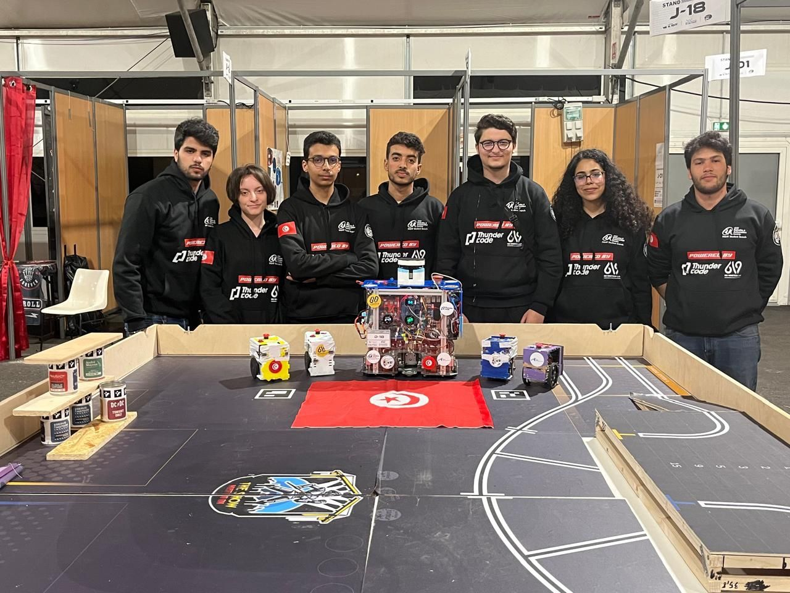
   <em>The team, the robot, and a project we built together.</em>

## The competition: The Show Must Go On

Eurobot is an international robotics competition in which teams design and build autonomous robots around a new theme each year. It brings together engineering, strategy, experimentation, and the challenge of making a machine work on a real playing field alongside another team's robot.

The 2025 theme, **"The Show Must Go On,"** imagined a charity concert tour: the **Robot-Rock-Tour**. The robots had to get the venue ready for the show. Missions included constructing audience stands from columns and wooden planks, displaying a promotional banner, bringing small robots into the performance, returning to the backstage area, and estimating the team's score. Teams could choose the actions they wanted to attempt and the order in which to perform them.

  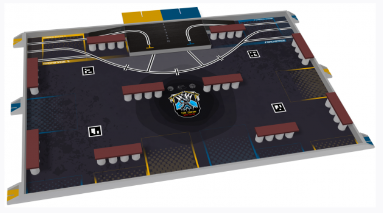
   <em>The field that turned the concert theme into a robotics challenge.</em>

For us, the engineering question was how to coordinate movement, construction, and obstacle handling within a **100-second match**. A useful strategy had to account for the pieces still available, the opponent's position, and the time left.

[Official Eurobot 2025 rules](https://www.eurobot.org/wp-content/uploads/2024/10/Eurobot2025_Rules_EN.pdf) · [Watch our robot demo in France](https://drive.google.com/file/d/1qwZ5hEaTdrVR_HJK0aNFYI3bHdSPBxDD/view?usp=sharing)

## Our robot and the team's design choices

Our main robot was built to collect and place the construction pieces. A stepper-driven forklift handles vertical movement, servos operate the gripping and placement mechanisms, and a pump supplies suction for holding a plank. The design also includes limit switches and a banner mechanism. These actions had to be coordinated with the robot's approach, orientation, and departure from each construction area.

<table>
  <tr>
    <td align="center" width="50%">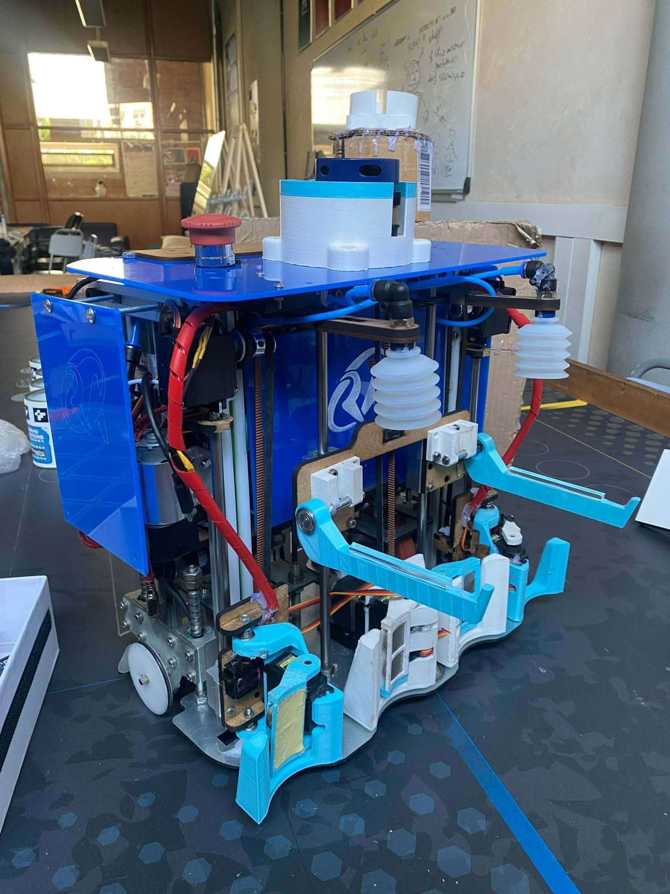 <em>Front: lifting and handling the game pieces.</em></td>
    <td align="center" width="50%">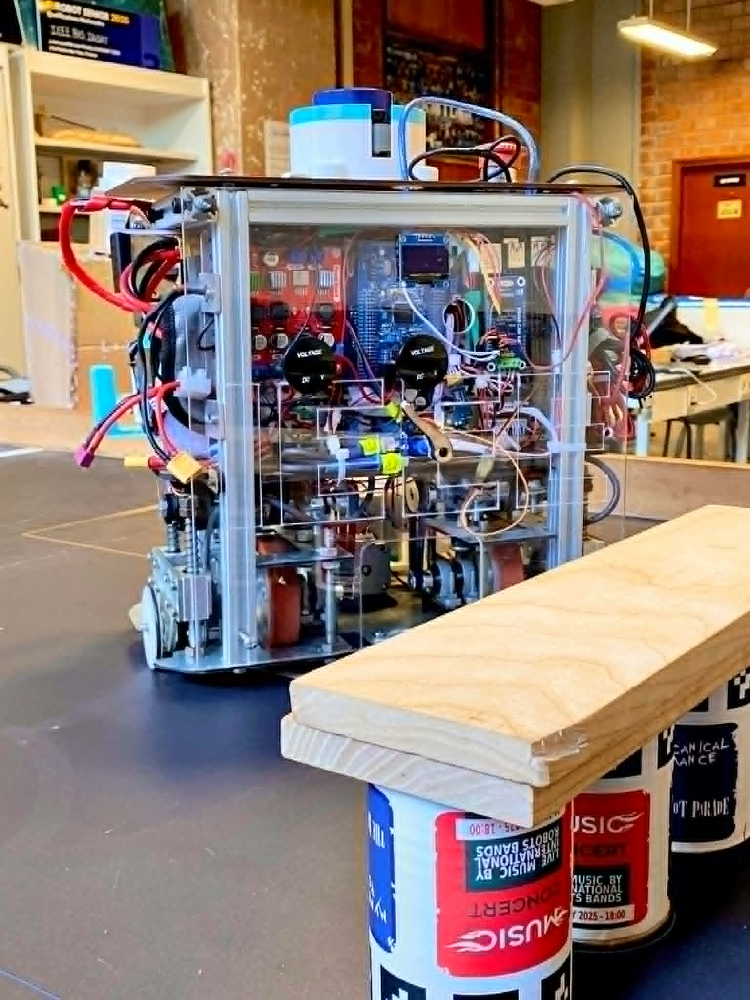 <em>Back: bringing the electronics and control together.</em></td>
  </tr>
</table>

We split the control work between a **Raspberry Pi 4 running ROS 2 Humble** and an **STM32F407**. The Pi coordinates the match, processes LiDAR data, and commands mechanisms. The STM32 handles motor control and encoder feedback. CAN connects the two boards, while a Maestro controller drives the servos over a serial connection. Custom power and interface boards support the different devices and their electrical connections.

  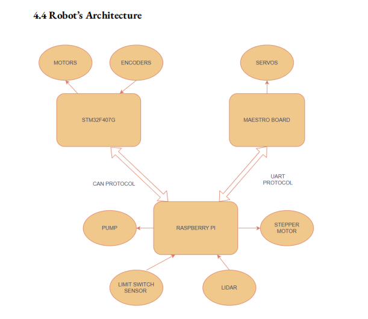
   <em>Our hardware architecture: each controller has a defined role.</em>

This division let us tune motion control separately from match strategy. Testing also showed why the physical robot had to guide our decisions: carrying planks changed its motion, and different surfaces changed its response. As described in our [design report](docs/robot-design-report.pdf), we refined the navigation controller and used different minimum motor commands for loaded and unloaded movement.

  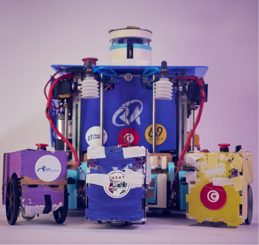
   <em>The main robot and its small companions, also called PAMIs.</em>

## How the ROS 2 architecture works

The software follows a repeated loop: **update the field state, choose the next objective, reach it, execute its actions, and update what remains**. ROS topics carry changing observations and commands; services let the state machine request the next task or subtask when it is ready.

  <a href="docs/ros-architecture.png">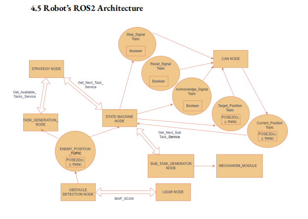</a>
   <em>The team's ROS 2 architecture sketch. The source also includes startup configuration, path planning, and visualization.</em>

The diagram below follows the connections in the workspace. Each box represents a software responsibility; several scripts create multiple ROS nodes to handle their publishers, subscribers, and services.

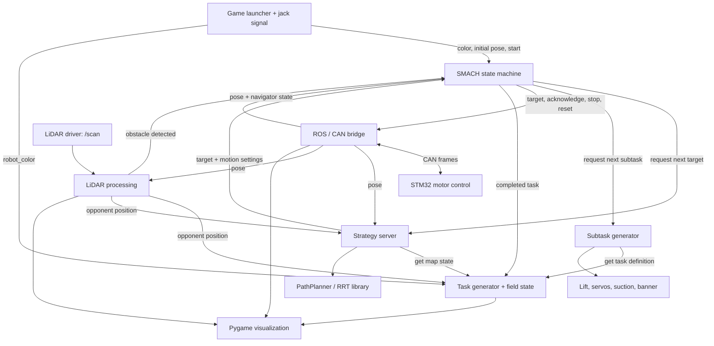

### 1. Preparing and starting the match

The [`jack_signal`](src/jack_signal/jack_signal) package handles the start conditions. `game_launcher.py` asks for the team's color, then publishes `robot_color` and `init_position`. The color selects the corresponding task layout and prohibited areas. `jack_signal_publisher.py` watches a Raspberry Pi GPIO input and publishes the latched start signal on `jack_signal`.

The state machine first establishes communication with the navigator and sends the initial pose. It waits for both the navigator's ready state and the jack signal before beginning the match. Its time counter then publishes `current_playing_time`, which is also used by the mechanism sequences and the return-to-finish logic.

### 2. Keeping track of the field and available tasks

[`static_task_generator.py`](src/strategy/strategy/static_task_generator.py) defines the task model and the blue and yellow configurations. A task contains a target pose, action type, score, direction, motion settings, load state, and an ordered list of subtasks. The action types cover normal navigation, building pickup, building placement, banner deployment, and returning to the finishing area.

Despite the filename, the available task list changes during execution. The generator subscribes to our pose, the detected opponent position, and the current task. Proximity checks are used to infer that a pickup location has been visited by the opponent; the code then adjusts the remaining pickup and placement sequence. Completed tasks can also be removed by a service request. This gives strategy an updated task list and obstacle list through `get_map_state_service`.

### 3. Choosing a target and finding a path

[`strategy_server.py`](src/strategy/strategy/strategy_server.py) answers `get_next_task_point_service`. It reads the current map state, selects the next task from the ordered available list, and uses our pose and the opponent's position to request a path. This is an ordered strategy with updates and fallback handling; the stored score is also used for match accounting.

The [`PathPlanner`](src/path_planning/path_planning/pathplanner.py) is a Python library called by strategy. Its modified **Rapidly-exploring Random Tree (RRT)** searches the 3 m by 2 m field using obstacle dimensions, the robot's footprint, and color-specific prohibited areas. It optimizes the resulting path, and strategy returns the next waypoint to the state machine. Intermediate waypoints are treated as navigation tasks; the final point retains the actual pickup, placement, or banner action. The full planned path is published on `strategy_rrt_path` for inspection.

The server also contains retries and task switching after repeated planning failures. These rules let the task sequence respond when an objective cannot be reached.

### 4. Supervising execution with SMACH

[`Eurobot2025_SMACH_V2.py`](src/eurobot2025_statemachine/eurobot2025_statemachine/Eurobot2025_SMACH_V2.py) coordinates the match using **SMACH**, a finite state machine library. The normal sequence passes through `Idle`, `Init`, `WaitForSignal`, `MoveOn`, `WaitToReach`, and `DestinationReached`. Pickup, placement, and banner tasks each have their own sequence for requesting and executing subtasks.

The state machine checks the navigator's reported state before moving on. Target commands, acknowledgements, arrival, blockage, and confirmed stops form a handshake between the Pi and the STM32. ROS callbacks run through a `MultiThreadedExecutor` in a separate thread while the SMACH execution runs in the main thread, allowing incoming feedback to update the state machine's decisions.

  <a href="docs/state-machine.jpg">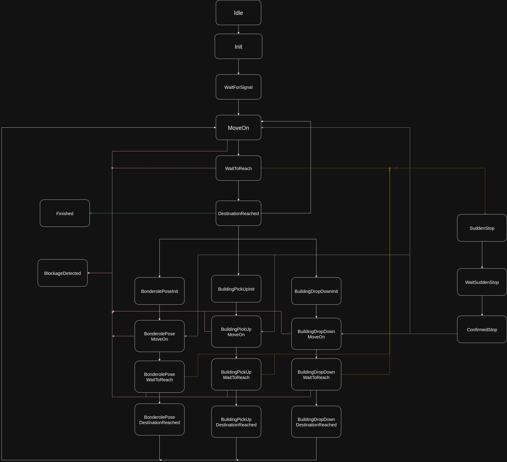</a>
   <em>The execution states and recovery paths. Click the diagram to inspect the full version.</em>

The supervisor also publishes `current_task`, `estimated_score`, and `current_direction`. A timer watches for a lack of movement during navigation; if the robot appears stuck, it can enter the stop-and-retry flow. The match clock controls return behavior and sends a reset command when the 100-second limit is reached.

### 5. Turning a task into mechanism actions

[`static_sub_task_generator.py`](src/strategy/strategy/static_sub_task_generator.py) serves `get_next_subtask`. Given a task ID and subtask index, it either returns a navigation command or calls a mechanism operation. Navigation and physical actions can therefore be interleaved: approach a pickup point, grip the cans, raise the lift, move to a placement point, and release the pieces.

The mechanism operations live in [`mecanisme`](src/mecanisme/mecanisme). `FirstMechanism` combines servo positions, stepper movement, pump control, and limit-switch inputs into actions such as holding cans, lifting planks, placing construction pieces, and releasing the banner. The subtask service calls these methods directly. Mechanism state is recorded to avoid repeating selected operations, and later construction steps check the remaining match time.

### 6. Closing the loop with CAN and LiDAR

[`ros_can_interface`](src/ros_can_interface/ros_can_interface) translates between ROS messages and the STM32's CAN protocol using `python-can` and Linux SocketCAN on `can0`. The configuration script uses **500 kbit/s**. Navigation commands include the target pose, forward or reverse travel, velocity and acceleration choices, and whether the robot carries platforms. The receiver decodes the current pose and navigator state and republishes them to ROS.

| Direction | CAN ID | Purpose |
| --- | --- | --- |
| Pi to STM32 | `0x000` | Stop |
| Pi to STM32 | `0x001` | Acknowledge |
| Pi to STM32 | `0x002` | Navigation target |
| Pi to STM32 | `0x003` | Reset |
| STM32 to Pi | `0x004` | Pose and navigator state |

The [`LiDAR scripts`](src/lidar_scripts/lidar_scripts) consume `sensor_msgs/LaserScan` on `/scan` from a LiDAR driver. They transform scan points into field coordinates using the robot's current pose, filter points against the field boundaries, and publish the closest detected obstacle as `Enemy_Robot_Position`. This position is used as an opponent estimate by strategy and task generation. The scripts also publish `Obstacle_Enemy_Detected` for a nearby obstacle. The `lidar_script_1_stop_dir.py` variant uses `current_direction` to check whether the obstacle lies in the direction of travel.

When that detection interrupts movement, SMACH passes through `SuddenStop`, `WaitSuddenStop`, and `ConfirmedStop`. It sends the stop command, waits for confirmation from the navigator, and resumes the appropriate navigation or construction sequence once the detection clears.

### The ROS interfaces connecting the pieces

[`ros_custom_messages`](src/ros_custom_messages) defines the shared messages and services. The navigation and task code uses **millimetres for position and degrees for heading**; the LiDAR code converts scan distances from metres before publishing field positions.

| Topic | Data | Role |
| --- | --- | --- |
| `robot_color`, `init_position`, `jack_signal` | `String`, `MasterNavigationMessage`, `Bool` | Configure and start the match |
| `ros_can_interface/master_nav` | `MasterNavigationMessage` | Send a motion target to the CAN bridge |
| `ros_can_interface/navigator_nav` | `NavigatorNavigationMessage` | Distribute pose and navigator feedback |
| `/scan` | `LaserScan` | Supply LiDAR measurements |
| `Enemy_Robot_Position` | `Point` | Share the detected obstacle/opponent position |
| `Obstacle_Enemy_Detected`, `current_direction` | `Bool` | Connect obstacle detection with execution and travel direction |
| `current_task`, `current_playing_time`, `estimated_score` | `CurrentTask`, `Int32`, `Int32` | Share match progress |
| `strategy_rrt_path` | `PathMsg` | Expose the planned waypoints |

| Service | Purpose |
| --- | --- |
| `get_map_state_service` | Read available tasks and obstacles |
| `get_next_task_point_service` | Request the next target and its motion settings |
| `get_next_subtask` | Execute or retrieve the next step of a task |
| `delete_task_service` | Remove a completed task |
| `switch_task_service` | Adjust the task sequence when planning repeatedly fails |
| `true_tasks_places_service` | Supply reference task positions to the visualization |

## Simulation and exploring the workspace

The [`simulation`](src/simulation/simulation) package contains Pygame tools for inspecting the field. `simulation.py` displays our pose, the detected opponent, task locations, and obstacles using ROS feedback and map services. `simulation_hbaieb.py` provides an interactive field and navigation control interface. These tools helped us reason about coordinates and behavior while developing the robot.

The workspace also preserves reserve-robot, homologation, and alternative strategy files. The [strategy launch file](src/strategy/launch/strategy_launch.py) groups the task generator, subtask generator, and strategy processes; the navigator bridge, LiDAR, jack, and state machine are separate components. The launch files and console entry points reflect different development configurations, so a deployment needs a consistent selection of those variants. This repository contains the ROS side of the system; the STM32 motion controller described in the report runs on the separate board.

For more on the complete robot, see the [project report](docs/robot-design-report.pdf).

## From the workshop to France

  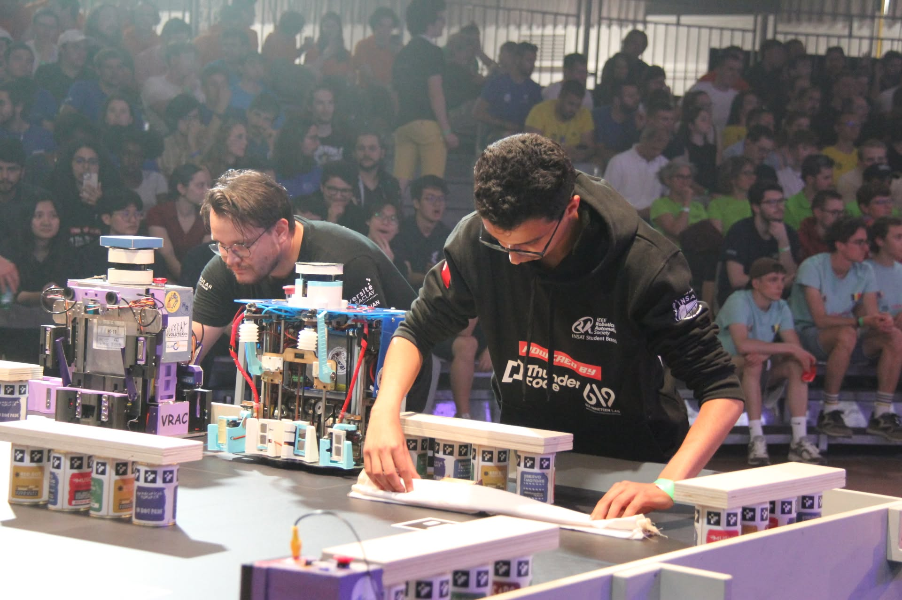
   <em>The work takes its place on the competition table.</em>

[**Watch our robot demo in France**](https://drive.google.com/file/d/1qwZ5hEaTdrVR_HJK0aNFYI3bHdSPBxDD/view?usp=sharing)

We remember the tests that sent us back to the drawing board, the relief when a fix finally worked, and the excitement of seeing something we had built move on the field in France. Every mechanism, circuit, and line of code carries part of that shared effort. Getting there meant learning to trust each other's work and continuing together when a test did not go as planned.

  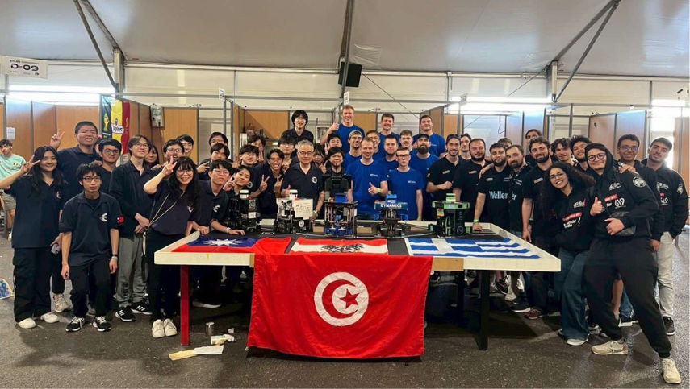
   <em>Sharing the experience with people who understand the same joy of building robots.</em>

We are grateful to everyone who designed, built, tested, encouraged, and traveled with us, and to our academic supervisor, **Mr. Mourad Moussa**, for his guidance. Alongside the technical lessons, we brought home the joy of working together, meeting other teams, and sharing a project that had become part of our lives.

**The show must go on. We are glad we got to build our part of it together.**
